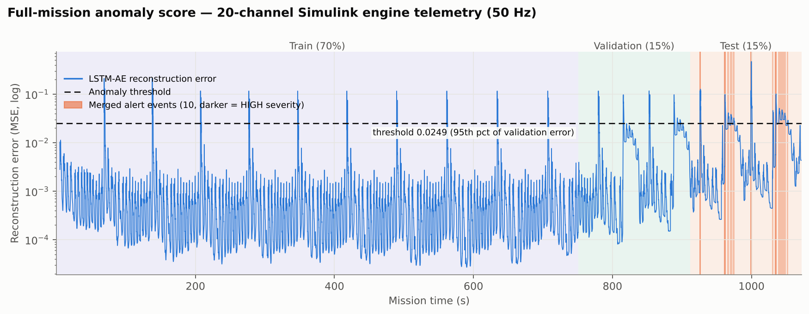
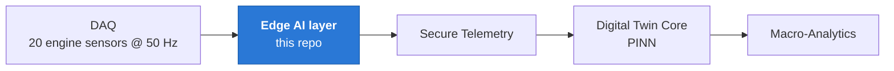
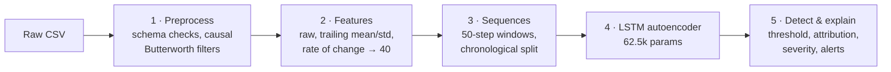
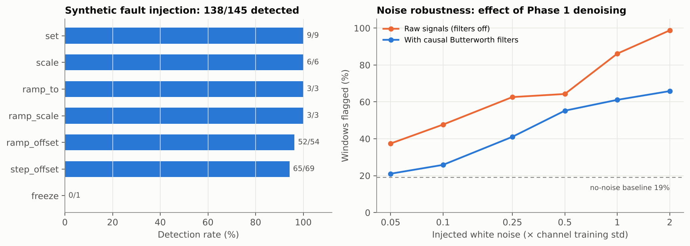

# UAV Engine Anomaly Detection: Edge AI Layer

**Real-time anomaly detection for MALE-UAV engine telemetry using an LSTM autoencoder.**
The pipeline denoises 20 sensor channels at 50 Hz, learns what healthy engine behaviour looks like, and flags
and ranks deviations: which channel is behaving abnormally, how severe it is, and whether it needs immediate
uplink to the ground station.




## Highlights

| | |
|---|---|
| **Fault detection** | **95%** of 145 synthetic fault scenarios detected (step, ramp, scale, set faults injected into raw telemetry and passed through the full pipeline) |
| **Fault localisation** | correct channel ranked #1 in **80%** of detections, top-3 in **88%** |
| **Calibrated threshold** | bootstrap 95% CI **[0.0241, 0.0261]** around the 0.0249 threshold, so the anomaly rate stays within 14.8–16.6% under resampling |
| **Denoising** | causal Butterworth filters cut false flags from **37% → 21%** under light sensor noise (0.05σ), against a 19% no-noise baseline |
| **No leakage** | chronological 70/15/15 split; scaler, filter cutoffs and threshold are fitted on train/validation data only |
| **Config-driven** | channels and parameters live in two config files, and a schema guard refuses to run a model that no longer matches its config |

## Where this fits

This repo is the **Edge AI layer** of a UAV engine Digital Twin / IVHM (Integrated Vehicle Health Management)
architecture:



Its job is **signal denoising, instantaneous anomaly detection and fault localisation**. RUL estimation,
physics-based state estimation and predictive maintenance belong to the downstream layers.

## Pipeline



| Phase | What it does |
|---|---|
| **1. Preprocessing** | Validates schema and timestamps, estimates per-channel noise, applies causal Butterworth filters, then per-channel correction rules. Cutoffs marked `'auto'` are derived from each channel's bandwidth on the training rows, saved, and **loaded (never re-derived)** at inference. Filters start at steady state, so large DC offsets (K, Pa) cause no start-up transient. |
| **2. Feature extraction** | Causal features for model-input channels (raw value, trailing mean/std, backward difference). The feature count is computed from the config and checked. |
| **3. Sequence preparation** | Chronological 70/15/15 split, 50-step windows within each split, a scaler fitted on train only, automatic detection of redundant channel groups, and metadata written with a config fingerprint. |
| **4. LSTM autoencoder** | `Input(50,40) → LSTM(64) → RepeatVector(50) → LSTM(64) → TimeDistributed(Dense(40))`. Early-stopped at epoch 83/100 (train loss 0.00141, val loss 0.00618). |
| **5. Anomaly detection** | Threshold = 95th percentile of **validation** reconstruction error. Adds per-channel attribution, bootstrap CI, fault-injection and noise-sweep validation, alert merging with severity tiers, and trend analysis. |

`Altitude` and `BaroPress` are excluded from the model (`model_input=False`). Altitude climbs monotonically, so
under a chronological split every validation and test sample would lie outside the training range. Both are
kept in the downstream handoff as context.

## Results

All figures come from the held-out **test split**. `detect_anomalies.py` reproduces them from the committed
model.



- **Threshold:** 0.024915 (95th percentile of validation reconstruction error).
- **Test-set anomaly rate:** 15.39% (1,230/7,994 windows), merged into **10 alert events** (4 HIGH, 4 MEDIUM,
  2 LOW; 4 flagged for immediate uplink). See `outputs/onboard_alert_log.jsonl`. All events fall at
  t = 924.9–1050.8 s and are dominated by TPS (5 events) and EngTrq (4 events).
- **Threshold stability:** bootstrap 95% CI [0.0241, 0.0261] (`outputs/threshold_bootstrap_ci.json`).
- **Fault injection:** 138/145 valid scenarios detected (49 scenarios × 3 locations in the test split, 2
  vacuous perturbations excluded). 100% on `set`, `scale`, `ramp_scale` and `ramp_to`. Weaker on gradual
  ramps and frozen sensors: a simulated TPS drift and an RPM sensor freeze were missed.
- **Attribution:** among detected scenarios, the top-1 channel matched the perturbed channel 110/138 times,
  and the true channel was in the top-3 for 121/138.
- **Noise sensitivity** (`outputs/noise_sweep.csv`): RPM, EngTrq, EGT, FuelFlow, TPS, OilPress and BusVoltage
  begin to false-flag at 0.05–0.25σ of added noise. MAT, CH, TurboSpd, OilTemp, InjTiming and the vibration
  channels tolerate up to ~2σ. This uses synthetic white Gaussian noise and has not yet been checked against
  real sensor noise.

> **Note:** `--mode inference` on the full training file reports ~3.7% anomalies, because that run includes
> the ~85% of rows the model trained and validated on. The **15.39%** test-split figure is the one that reflects
> generalisation.

## Quick start

```bash
git clone https://github.com/sahitidomudala-hub/Male-uav.git
cd Male-uav
python -m venv .venv
source .venv/bin/activate          # Windows: .venv\Scripts\activate
pip install -r requirements.txt

# Score a telemetry file with the committed model (nothing is refit or retrained)
python run_pipeline.py --mode inference --input data/raw/Simulink_Telemetry_Run.csv
```

Results go to `outputs/inference_results.csv` (per-window error and Normal/Anomaly) and
`outputs/downstream_health_vector.csv` (the handoff for downstream layers, see
[`DOWNSTREAM_HANDOFF.md`](DOWNSTREAM_HANDOFF.md)). To score your own file, it needs the same 21 columns
(`Time` + 20 channels) as the sample.

## Reproduce from scratch

Run from the repo root. Scripts locate the repo from their own path, so they also work from other directories.

```bash
# 1. Prepare data (fits filter cutoffs and scaler on the TRAINING rows only)
python phase1_preprocessing/preprocess.py data/raw/Simulink_Telemetry_Run.csv
python phase2_feature_extraction/extract_features.py data/processed/cleaned_telemetry.csv
python phase3_sequence_preparation/prepare_sequences.py data/features/extracted_features.csv data/sequences

# 2. Train (slow on CPU; run uninterrupted)
python phase4_autoencoder/train_autoencoder.py --sequences-dir data/sequences --output-dir .

# 3. Threshold, attribution, validation evidence, alerts
python phase5_anomaly_detection/detect_anomalies.py --base-dir .
python phase5_anomaly_detection/attribute_anomalies.py --base-dir .
python phase5_anomaly_detection/bootstrap_threshold.py --base-dir .
python phase5_anomaly_detection/fault_injection_validation.py --base-dir .
python phase5_anomaly_detection/noise_sweep.py --base-dir .
python phase5_anomaly_detection/generate_alerts.py --base-dir .
python phase5_anomaly_detection/trend_analysis.py --base-dir .

# 4. Validate every phase
python phase1_preprocessing/validate.py data/raw/Simulink_Telemetry_Run.csv data/processed
python phase2_feature_extraction/validate.py --input data/processed/cleaned_telemetry.csv
python phase3_sequence_preparation/validate.py --input data/features/extracted_features.csv
python phase4_autoencoder/validate.py --base-dir .
python phase5_anomaly_detection/validate.py --base-dir .
```

## Design: nothing is hardcoded in logic files

| Where | What lives there |
|---|---|
| `channel_config.py` | one entry per channel: correction rule, moving-stats / rate features, filter, `model_input`, unit |
| `pipeline_config.py` | every global parameter: split, sequence length, thresholds, filter derivation, model/training settings, severity tiers, sweep settings, fault presets |
| trained artifacts | everything tied to the model: feature names and order, sequence length, stride, sampling rate, redundant channel groups (`data/sequences/metadata.json`), scaler, filter cutoffs (`models/filter_params.json`), threshold (`outputs/anomaly_detection_report.json`) |
| `schema_guard.py` | refuses to run if the config no longer matches the trained artifacts ("RETRAIN REQUIRED") |

**To add or change a channel:** edit only `channel_config.py`, re-run Phases 1–3, then retrain (the model input
size changes). The schema guard turns a forgotten retrain into an error instead of silent misuse. See
[`QUICK_REFERENCE.md`](QUICK_REFERENCE.md).

## Repository layout

```
├── run_pipeline.py              # CLI entry point (preprocess / features / sequences / train / detect / inference)
├── inference_core.py            # scores new files with saved artifacts only
├── channel_config.py            # per-channel configuration
├── pipeline_config.py           # global parameters
├── schema_guard.py              # config ↔ artifact consistency check
├── phase1_preprocessing/ … phase5_anomaly_detection/   # one folder per phase, each with validate.py
├── models/                      # trained LSTM autoencoder, scaler, filter cutoffs
├── data/raw/                    # sample Simulink telemetry (53.6k rows × 20 channels)
├── data/sequences/metadata.json # feature order, window length, sampling rate, config fingerprint
└── outputs/                     # threshold report, validation evidence, alert logs
```

## Outputs

| File | Meaning |
|---|---|
| `outputs/inference_results.csv` | per window: error, threshold, Normal/Anomaly |
| `outputs/downstream_health_vector.csv` (+ `_units.json`) | candidate handoff for downstream layers, see `DOWNSTREAM_HANDOFF.md` |
| `outputs/inference_noise_estimate.json` | per-channel high-frequency noise estimate of the scored file |
| `outputs/anomaly_attribution.csv` | top channels per window (deviation ranking, not root cause) |
| `outputs/threshold_bootstrap_ci.json` | threshold stability |
| `outputs/fault_injection_validation.csv` | labelled synthetic faults: detected? attributed? |
| `outputs/noise_sweep.csv` | added-noise tolerance, with and without Phase 1 filters |
| `outputs/onboard_alert_log.jsonl`, `priority_alerts.jsonl` | merged events with severity; HIGH flagged for immediate uplink |
| `outputs/trend_analysis.json` | descriptive error-over-time summary |

Inference scratch files go to `data/inference/`, so scoring a new file never overwrites the training-side
`data/processed` / `data/features` used by the Phase 5 scripts.

## Known limitations

- The data is a **fault-free, noise-free Simulink simulation**. The anomaly rate is set by the percentile
  threshold (a share of healthy validation data is flagged by construction). It is not a fault rate, and no
  precision or recall can be claimed. Evidence of detection ability comes from the synthetic fault-injection
  and noise-sweep results.
- Reconstruction error rises in the validation and test periods (see the timeline). Part of the late-mission
  flagging likely reflects operating conditions not seen in the first 70% of the run, not faults.
- Vibration values are engineering estimates. `Vib2X` and `InjTiming` are exact functions of `Vib0p5X` and
  `FuelFlow` in this simulation (detected automatically as redundant groups), so attribution is shared across
  them.
- Attribution ranks which channel deviates most from learned normal behaviour. It is not root-cause analysis.
- Filter cutoffs are bandwidth-based, not noise-optimised, and noise tolerance has not been checked against
  real DAQ noise.
- Timestamps are mission-elapsed seconds, not UTC. Inference works on files; live streaming ingestion and
  on-board latency/memory profiling are not yet done.


